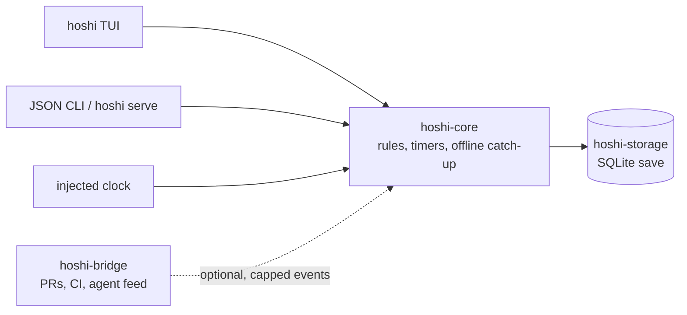

# hoshi (星)

**An idle space empire that grows in a terminal pane while your coding agents work.**

[](https://github.com/Sannrox/hoshi/actions/workflows/ci.yml)
[](https://github.com/Sannrox/hoshi/releases)
[](LICENSE)

[Try it](#try-it) · [Install](docs/install.md) · [Scriptable CLI](docs/cli.md) · [Realism](docs/realism.md) · [Decisions](docs/decisions/README.md)

> Status: hobby project, pre-alpha.

Hoshi (星, "star") is a real-time idle space-strategy game for the terminal,
built with [ratatui](https://ratatui.rs). Inspired by the classic browser
space-empire games: mine resources, raise buildings, research technologies,
build fleets and send them on expeditions. Meant to be played in a spare
terminal pane while your coding agents work.

- **Real time, even while you are away.** Timers keep running; continuing
  after a long gap lists deliveries, stalls and completed items.
- **A complete game on its own.** Economy, research, fleets, colonies, story
  events, trade, wonders, prestige, daily goals and achievements, with no
  account, network connection or AI service.
- **Your agents can play along.** An optional, off-by-default bridge turns
  merged pull requests, CI results and a local activity feed into small,
  capped game events.
- **Scriptable by the same rules.** JSON commands, an optional local server
  and a bot arena share the TUI's core actions.
- **Saves are plain files.** SQLite by default, with optional object-log and
  object-graph backends behind cargo features, and migrations on schema
  changes.
- **Honest terminal rendering.** Colours follow terminal depth down to
  `NO_COLOR`, portraits fall back to ASCII, and keys are remappable.

## Try it

The toolchain is pinned by `rust-toolchain.toml`:

```sh
git clone https://github.com/Sannrox/hoshi && cd hoshi
cargo run -p hoshi
```

`hoshi` opens on a title screen (continue, new, load, settings). Prebuilt
binaries, an Ubuntu install script and Homebrew are under
[Install](#install).

The same binary plays headless. Create a save and print its state as JSON:

```sh
cargo run -p hoshi -- --save demo.sqlite --seed 1 state
```

```json
  "resources": {
    "deuterium": 0.0,
    "helium_3": 0.0,
    "iron": 500.0,
    "rare_earths": 0.0,
    "silicon": 500.0,
    "water_ice": 0.0
  },
```

Or let the balance simulator play three in-game days and grade the pacing:

```sh
cargo run -p hoshi -- simulate --days 3
```

```text
Simulated days: 3
...
- first upgrade: 138s (pass)
```

## How it works



`hoshi-core` is the single authority for rules and state; the TUI renders and
sends commands but holds no rules. Time is injected, so ticks are
deterministic and catching up after a long gap resolves to the same state as
ticking step by step. Saves go through `hoshi-storage`; core never opens a
database, and the bridge never writes the save. Story content is drafted
offline by the `hoshi-author` CLI; the game never generates events or calls a
model at runtime. The design is recorded in
[ADR 0002](docs/decisions/0002-terminal-idle-game-with-event-bridge.md).

| Crate | Role |
| --- | --- |
| `hoshi-core` | Rules, state, timers, offline progression |
| `hoshi-storage` | Save backends (SQLite default; optional Mikura / Chisei) |
| `hoshi` | Playable binary (ratatui; sources in `crates/hoshi-tui`) |
| `hoshi-bridge` | GitHub and agent events into game events |
| `hoshi-author` | Offline drafts of story events (`content/drafts/`); never runs in the game |

## A standalone game first

hoshi is a complete game on its own: economy, research, fleets, colonies,
story events, trade, wonders, prestige, daily goals and achievements. No
account, network connection or AI service is needed. The local game stays
single-player ([ADR 0004](docs/decisions/0004-no-shared-universe.md)); a shared
universe exists only as a shard hosted on Chisei ([ADR 0005](docs/decisions/0005-shared-shard-on-chisei.md)).

## Optional: your agents play along

An optional bridge, behind the `bridge` cargo feature and a config switch,
both off by default, turns your development activity into small, capped game
events. It reads only free signals: local event files or sockets, and GitHub
through your own `gh` login. It never calls AI models or any paid service, and
the game is balanced without it.

- a merged pull request pays out resources;
- green CI boosts production or research;
- red CI or a stuck agent attracts a pirate raid;
- any agent tool can post to a local activity feed shown in the game.

With `--features bridge` and the bridge enabled, a status bar shows the latest
feed event and `a` opens the activity log.

## Playing

### The empire

Mines run production chains from planet deposits to ship parts. The market
trades metal, crystal and deuterium at drifting prices. Three NPC factions
keep standing that trades, raids, conquest and story choices move. Story
events offer numbered choices on a cooldown; ignored too long uses the
default. Fleets fly on timers. Colony ships settle empty planets. Pirate
outposts take a fleet attack then a troop landing; pirate raids land on a
countdown. Formations and stances sit on the fleet resolver; Neutral keeps
the old results. A prestige reset starts a new galaxy with kept bonuses.

Galaxy seeds are short checksummed codes (`hoshi new --seed`; `y` copies the
current save's code from the title menu, Load, and the overview). New game
previews a pasted seed before creating the slot and applies purchased
starting bonuses. Title Achievements lists unlocks and career totals across
saves without opening a slot for writing. Title Prestige (hidden until a
reset is available) shows currency and the bonus shop.

### Screens and keys

Play opens on the bridge: alerts, star map, upcoming events, queues and
fleets under a resource strip. Continue after a long gap lists deliveries,
stalls and completed items. Screens sit in six hubs that open as windows over
the bridge:

| Hub | Screens |
| --- | --- |
| 1 bridge | dashboard, goals, daily, feats |
| 2 colony | buildings, production, maintenance, research, wonder |
| 3 fleet | shipyard, star map, ops (mission schedule), intel |
| 4 trade | market, finance, KPIs |
| 5 empire | diplomacy, laws, staff (leaders and roles), automation, incidents |
| 6 records | history, scenarios, legacy |

Keys: `1`-`6` (open a hub, press again for its next tab), `tab` / `shift+tab`
(next or previous screen), `esc` (back to the bridge), `j`/`k` (select),
`enter` (build or research), `x` (cancel), `q` (quit and save), `?` (help for
this screen). Remap them with `keys.<action>` lines in `config.toml` or from
title Settings → keybindings; a conflict keeps the current keys.

Enter queues a build, a ship, research, or a wonder contribution; in the
shipyard `+`/`-` set how many ships or defences one Enter queues as a single
job (space: as many as the stock pays for). Hub screens are tables with the
inspector beside them: dispatch docks there on the star map, where space
picks its mission (attack, spy, invade, colonize or expedition); on an own
colony it is a transport from home, with `+`/`-` cargo rows for iron, silicon
and deuterium. Overlays open as dialogs over the dimmed screen, and the title
menu lists saves beside the menu at 90 columns and up. The records hub keeps
a searchable history log; time travel on that log shows a recorded empire
glance.

Colours follow terminal depth (truecolor, 256, 16, or none with `NO_COLOR`);
`high_contrast = true` drops background fills. `--no-portraits` keeps ASCII
drawings and skips RGB.

### Saves and balance

The save file lives in the user data directory (`hoshi/save.sqlite`).
Override the path with `--save PATH` or `HOSHI_SAVE`. A `*.mikura` path needs
`--features mikura` (an object log); a `*.chisei` path needs
`--features chisei` (an object-graph directory) —
[docs/storage.md](docs/storage.md), [docs/chisei.md](docs/chisei.md). Balance
numbers load from the bundled `balance.toml`; override with `--balance PATH`
or `HOSHI_BALANCE`.

### Assists and settings

The local AI advisor is off until `ai_advisor = true` or `--advisor`; `i`
opens suggestions and `hoshi advise` prints the same list as JSON without
acting. `focus = "conquest"`, `"wonder"` or `"diplomacy"` in `config.toml`
puts that victory path's next step first in both and drops idle-queue alerts
for colonies other than home; leave it out for the full list. Optional
`--features advisor-model` plus `advisor_model_url` rephrases through a local
HTTP endpoint (loopback, or a private IPv4 host when `advisor_allow_lan` is
set); public and cloud hosts stay refused, and a timeout falls back to the
rule text. Settings → advisor model edits the endpoint and model name and
tests the connection without freezing the menu; without
`--features advisor-model` the page still saves config and notes that
rephrase is compiled out.

Combat replay commentary is off until `commentary = true` in `config.toml` or
`--commentary`. Optional `--features commentary-model` plus
`commentary_model_url` rephrases lines through a loopback HTTP endpoint only.

Notifications are off until Settings (or `notify = true`); they use the
terminal bell and OSC 9/777, with per-type toggles and quiet hours in the
same file.

## Scriptable play

Scriptable JSON commands (`hoshi state`, `advise`, `log`, `staff`, `vehicle`,
`mission`, `classify`, `share`, `incidents`, `maintenance`, `build`,
`research`, `cancel`, `fleet send`, `tick --advance`, `feedback`) share the
TUI's core actions. See [docs/cli.md](docs/cli.md).

```sh
hoshi simulate --days 3
hoshi --self-play self-play --matrix pr
```

prints a pacing report (first upgrade time, daily mine levels, bridge-effect
ratio). Targets live in [docs/balance.md](docs/balance.md).

Optional `hoshi serve` wraps one local save behind `/healthz`, `/v1` actions,
and a `/v1/events` WebSocket ([docs/server.md](docs/server.md)); `/v1` needs
a bearer token. Release binaries also serve the web client at `/ui/`. It is
not a shared universe.

Opt-in bot arena: `hoshi --arena arena run --seed N --days N bot...`
([docs/arena.md](docs/arena.md)); it never calls a model. Opt-in governance
demo (needs `--features chisei`): `hoshi --demo demo governance --seed N`
([docs/demo.md](docs/demo.md)); recorded replies only, no HTTP. Playtest
checklist: [docs/playtest.md](docs/playtest.md). Writers draft story events
with `hoshi-author events draft` ([docs/authoring.md](docs/authoring.md));
the game never calls a model.

## Install

Install steps, binary names and save-schema notes: [docs/install.md](docs/install.md).
The playable crate is named `hoshi`.

```sh
cargo install --git https://github.com/Sannrox/hoshi --locked hoshi
```

Version tags (`vX.Y.Z`) publish GitHub Release binaries for Linux (x86_64, aarch64),
macOS (Intel and Apple Silicon) and Windows, Ubuntu `.deb` packages (22.04+,
amd64 and arm64), plus `SHA256SUMS`. Ubuntu:

```sh
curl -fsSL https://raw.githubusercontent.com/Sannrox/hoshi/main/scripts/install.sh | sh
```

Alpha testers can take the nightly build of `main` with `HOSHI_CHANNEL=nightly`
before `sh` ([docs/install.md](docs/install.md#nightly-builds)). Homebrew:

```sh
brew tap Sannrox/tap
brew install hoshi
```

The tap formula is regenerated by the release workflow.

## Develop

```sh
cargo fmt --all -- --check
cargo build --locked --workspace --all-targets
cargo clippy --locked --workspace --all-targets -- -D warnings
cargo test --locked --workspace
bash scripts/validate-workflow-skills.sh
```

Policy for contributors and agents: [AGENTS.md](AGENTS.md). Decisions:
[docs/decisions/](docs/decisions/README.md). Physics and maths for design
work: [docs/realism.md](docs/realism.md). Portrait art and licenses:
[crates/hoshi-tui/ASSETS.md](crates/hoshi-tui/ASSETS.md).

## License

Apache-2.0. See [LICENSE](LICENSE).

For optional local experimentation, see [Cheats](docs/cheats.md).

For local diagnostic reports and crash files, see [Support reports](docs/support.md).
